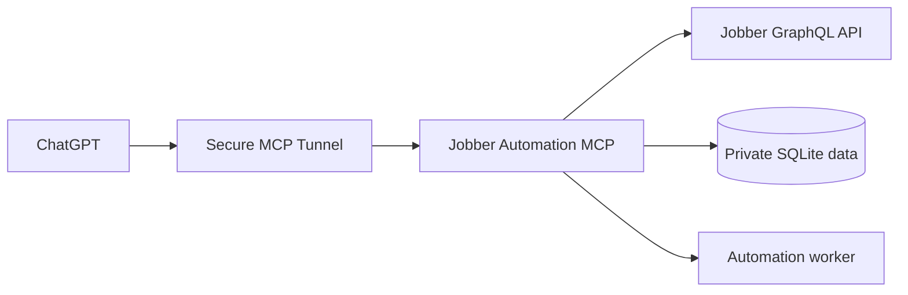

# Jobber Automation MCP

A self-hosted MCP server that lets ChatGPT inspect Jobber data and manage controlled automations. The same Docker Compose stack runs on macOS, Linux, and Raspberry Pi ARM64.

This is an early single-owner build. It is not designed for public or multi-tenant hosting.

Current release: **v0.3.0**

## Architecture



The MCP server defines the tools ChatGPT may call. The worker executes saved schedules even when no chat is open. The action catalog is intentionally controlled; automation definitions cannot execute arbitrary operating-system commands.

## Current capabilities

- Jobber OAuth authorization-code flow and rotating refresh-token support
- Jobber account, client, and job queries
- Read-only GraphQL and confirmed-mutation escape hatches
- SQLite persistence with WAL mode and a private database file
- Automation create, list, get, update, activate, pause, preview, run-now, history, and delete tools
- Manual, repeating interval, and DST-safe daily local-time triggers
- Log, Jobber query, Jobber mutation, and **guarded dynamic mowing carryover** actions
- Draft-on-create and draft-after-edit review lifecycle
- Per-run approval or explicitly preapproved automation policies
- Background scheduler with run and audit history
- Docker packaging compatible with macOS development and Linux ARM64 Raspberry Pi hosts

## Safety behavior

- New and edited automations are drafts and cannot run.
- Activation requires the exact phrase `I APPROVE THIS AUTOMATION`.
- A Jobber mutation automation using `always` approval cannot mutate from the scheduler.
- Its manual run requires `I CONFIRM THIS AUTOMATION RUN`.
- A `preapproved` mutation automation can run unattended only after its complete definition is reviewed and activated.
- Dynamic carryover is scoped to one Jobber client ID and an **exact required crew**; it never reassigns workers, moves completed visits, or touches unrelated clients.
- Carryover skips excluded properties, later duplicate visits, and jobs with unresolved access, construction, animal, or do-not-mow notes. If notes or visit history cannot be fully reviewed, it skips the job.
- Each moved visit is rechecked immediately before its write; every attempt and success is recorded in audit history. An approved maximum limits the number of possible moves per run.
- Generic one-off mutations require clear explicit approval after the proposed change is shown. Accepted wording includes `yes`, `do it`, `approved`, and `I CONFIRM THIS JOBBER CHANGE`.
- OAuth state is hashed, single-use, and expires after ten minutes.
- Every mutation attempt and automation result is audited.

## Installation

Version 0.3.0 provides a local browser installer for Windows x64, macOS Intel/Apple Silicon, Linux x64, and Raspberry Pi/Linux ARM64. Download the matching release bundle, extract it, and open **Start Setup**. The installer checks Docker, collects the Jobber and OpenAI tunnel settings, generates the private MCP path and setup secrets, starts both containers, and opens Jobber authorization.

No Node.js, Git, `.env` editing, secret-generation commands, or Docker commands are required. Docker Engine with Compose remains the trusted system prerequisite; if it is missing, the wizard opens the official installation instructions.

Start with the documentation that matches the task:

- [Installation and updates](docs/INSTALL.md)
- [Raspberry Pi deployment and migration](docs/RASPBERRY_PI.md)
- [Backup, restore, and rollback](docs/BACKUP_RESTORE.md)
- [Security policy](SECURITY.md)
- [Version history](CHANGELOG.md)

Quick local development setup requires Node.js 22.5 or newer:

```bash
npm install
npm run build
npm start
```

The database defaults to `./data/jobber-mcp.sqlite`.

## ChatGPT MCP endpoint

The local MCP path is:

```text
http://localhost:8080/mcp/YOUR_MCP_PATH_TOKEN
```

The included Compose file runs the OpenAI Secure MCP Tunnel alongside the server. Both published ports bind only to host loopback; do not expose them through router port forwarding.

## Automation definition example

```json
{
  "name": "Hourly account check",
  "description": "Verify that Jobber remains reachable.",
  "approvalPolicy": "always",
  "trigger": { "type": "interval", "everyMinutes": 60 },
  "actions": [
    {
      "type": "jobber.query",
      "query": "query Account { account { id name } }"
    }
  ]
}
```

The MCP tool creates this as a draft. Preview it, activate it, and then inspect its history.

## Dynamic nightly mowing carryover (available on this branch)

Configure this through the MCP \`automation_create\` tool. It is created as a **draft**; creating it does not change any Jobber visit. Fill in the **actual Jobber IDs** obtained using read-only tools. Use one client ID (not an unverified client name), and the exact allowed crew user IDs. Do not put private customer IDs or secrets in the public repository.

\`\`\`json
{
  "name": "Nightly mowing carryover",
  "description": "Carry incomplete approved-crew mowing visits to tomorrow.",
  "approvalPolicy": "preapproved",
  "trigger": {
    "type": "daily",
    "time": "22:30",
    "timeZone": "America/Indiana/Indianapolis"
  },
  "actions": [{
    "type": "jobber.carryoverMowing",
    "clientId": "<Jobber client encoded ID>",
    "requiredAssigneeIds": [
      "<Jonathan user encoded ID>",
      "<Evan user encoded ID>",
      "<Nolan user encoded ID>"
    ],
    "excludedJobNumbers": [227, 243],
    "timeZone": "America/Indiana/Indianapolis",
    "maxMoves": 15
  }]
}
\`\`\`

The action examines **only visits scheduled for the current local day** which are still incomplete, are on a mowing job for that exact client, and are assigned to exactly the listed crew. It skips visits when the same job has another scheduled visit in the following two days. It checks up to 100 notes and 100 historical visits per job; if either history is truncated, it **skips rather than guessing**. Permanent do-not-mow notes are never automatically cleared. A temporary access blocker is treated as cleared only when a subsequent completed visit exists. Scheduled start and end dates are moved together to the **next calendar day**. The job remains assigned to the same crew.

Use \`automation_preview\` to inspect the definition, and **\`automation_plan\`** to inspect the *live* read-only list of eligible and skipped visits before activation. The user must explicitly approve the complete scope before invoking \`automation_activate\` with its required phrase. Once a \`preapproved\` automation is active, it can carry over jobs unattended. Pause it with \`automation_pause\`.

The bridge must be deployed and its worker enabled to execute this; committing a branch or merging a pull request does **not** update the running Docker container. Once the bridge is successfully deployed and the Jobber automation is activated, disable any redundant ChatGPT nightly review task to avoid duplicate notifications.

## Development

```bash
npm run check
```

The test suite covers GraphQL operation separation and the local automation lifecycle.

## Release policy

Versions use `MAJOR.MINOR.PATCH` Semantic Versioning. Every release receives a Git tag and a matching changelog entry. Until v1.0, minor releases may include substantial changes that require reviewing the migration notes.

## Planned work

- Named Jobber tools based on the authenticated schema instead of generic GraphQL
- Calendar/cron, Jobber polling, and webhook-relay triggers
- Conditions, templates, notifications, retries, and idempotency keys
- Embedded MCP Apps automation dashboard
- Encrypted or operating-system-backed token storage
- Automated backup verification and simpler restore commands
- Purpose-built scheduling and visit-management workflows

## Important limitations

- Scheduled work runs only while the host is awake and the server is running.
- A Secure MCP Tunnel connects ChatGPT to MCP; it is not a general inbound Jobber webhook endpoint.
- Jobber fields and mutations must be verified against the authenticated schema and selected API version before production use.
- Do not expose the local port directly to the public internet.

## License

Released under the [MIT License](LICENSE).
